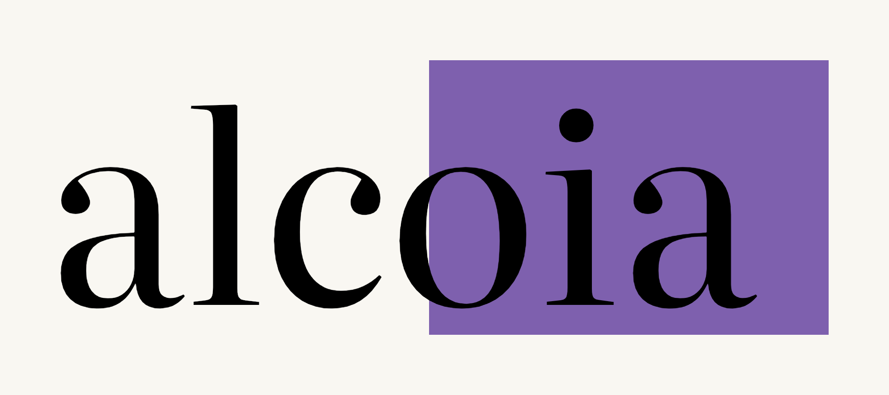

<p align="center">
  
</p>

<p align="center">
  <a href="LICENSE"></a>
</p>

Alcoia is a browser extension for Chrome and other Chromium-based browsers. A Firefox build target exists but is tested less. It watches reading signals on the page you are reading, and when you slow down or re-read a passage it asks a short question about that passage. A correct answer ends the interaction. A wrong answer gets an explanation with the key terms highlighted.

It works on web pages, PDFs and PowerPoint files opened from your computer, and on readings assigned through a class.

## Install

Alcoia is in early access. To get an invitation, join the waitlist at [alcoia.app/waitlist](https://alcoia.app/waitlist).

To run it from source:

```bash
git clone https://github.com/alcoia-group/alcoia.git
cd alcoia
npm ci
```

- **Chrome:** open `chrome://extensions`, turn on Developer mode, choose Load unpacked and select the `alcoia/` directory.
- **Firefox:** run `npm run build:firefox`, open `about:debugging`, choose Load Temporary Add-on and select `dist/firefox/manifest.json`.

After installing, alcoia does nothing on ordinary websites until you allow it. Open the toolbar popup on a page and switch on "Use alcoia on this site", or switch on all websites in Settings, "Where alcoia runs". It stays off on banking, health, webmail and similar pages whatever you choose.

The AI features (questions, explanations, summaries) call the Alcoia server at `https://server.alcoia.app`. The server is a separate private project. To test against your own backend, set a Backend URL under developer tools in the extension settings.

## Build and test

```bash
npm ci
npx eslint .            # lint
npm test                # unit tests (Vitest)
npm run build           # builds dist/chrome and dist/firefox
npm run test:browser    # runs the extension in a real Chromium; needs `npx playwright install chromium`
```

`npm run build:chrome` and `npm run build:firefox` build one target.

## Project layout

```
alcoia/              the extension (loaded unpacked as-is; no bundler)
  background.js      service worker
  src/content/       reading detection, the question card, the quiz
  src/popup/         the popup and the extension's own pages
  src/shared/        server clients and local storage helpers
  src/pdf-viewer/    local PDF viewer
  src/pptx-viewer/   local PowerPoint viewer
  src/libs/          third-party code and fonts
manifests/           manifest source for each browser
tests/               Vitest suite and the browser smoke test
tools/               build and review scripts
docs/                architecture and licence notes
```

[`docs/ARCHITECTURE.md`](docs/ARCHITECTURE.md) explains how detection, the state engine and the interruption budget fit together.

## Privacy

- **Sent to the server:** the text of the passage, to generate a question or an explanation. Requests carry an install token (a random identifier created on first run) that is not derived from your device or network.
- **Signed in with an Alcoia account:** your plan, your class membership and learning-memory settings are read from the server. With account-based learning on, answers to questions are stored on your account.
- **In a class assignment:** answers and difficulty signals for that reading are reported to the class under the reporting mode (anonymous or identified) shown when you join.
- **Anonymous counters:** a few daily counts, for example how often question generation failed, are sent only when the server turns this on. They contain no page, text or account.
- **Stays on your device:** your reading speed baseline, settings, highlights, notes, quiz records, reading receipts and the list of ideas noticed on web pages.
- **Not in the extension:** there is no camera or eye tracking code, and no analytics service. Fonts are bundled, and nothing is requested from third-party hosts.

The full policy is at [alcoia.app/legal/privacy-policy](https://alcoia.app/legal/privacy-policy). See also [`PRIVACY.md`](PRIVACY.md).

## Contributing, security, conduct

- [CONTRIBUTING.md](CONTRIBUTING.md)
- [SECURITY.md](SECURITY.md)
- [CODE_OF_CONDUCT.md](CODE_OF_CONDUCT.md)

## Licence

[AGPL-3.0](LICENSE). Third-party components are listed in [`docs/NOTICE.md`](docs/NOTICE.md).
